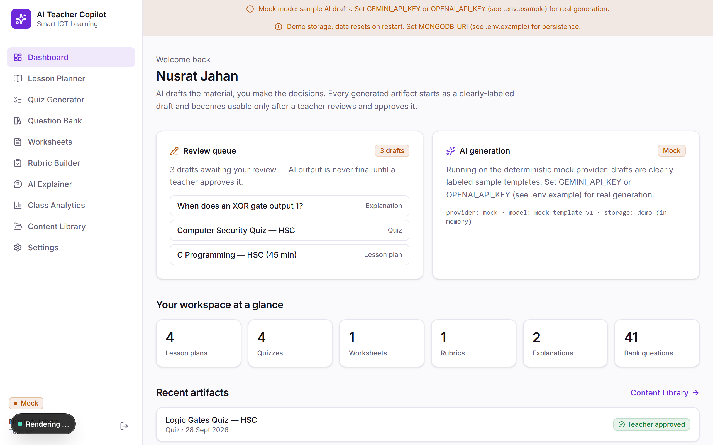
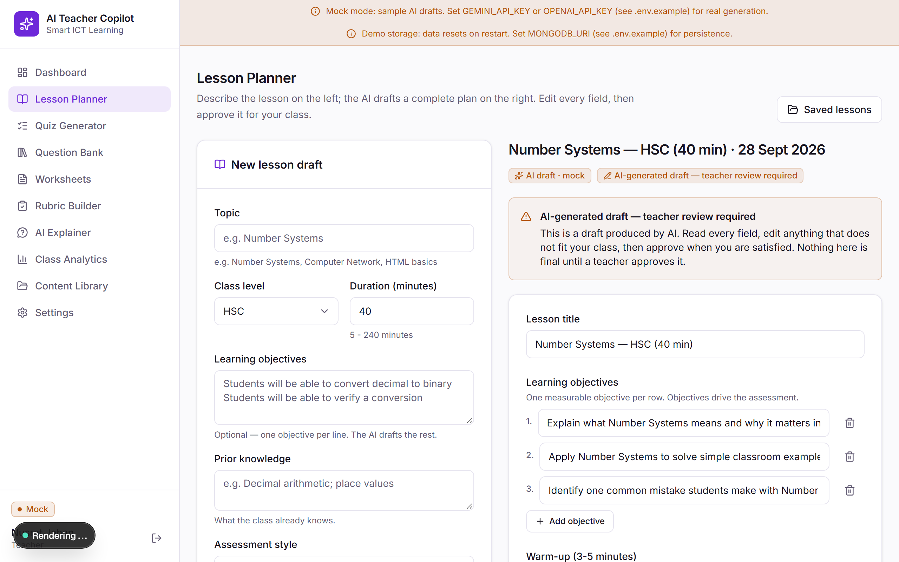
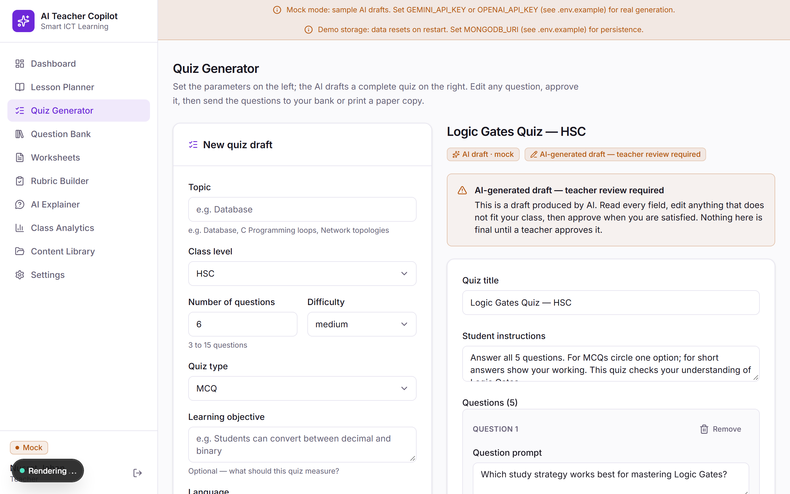
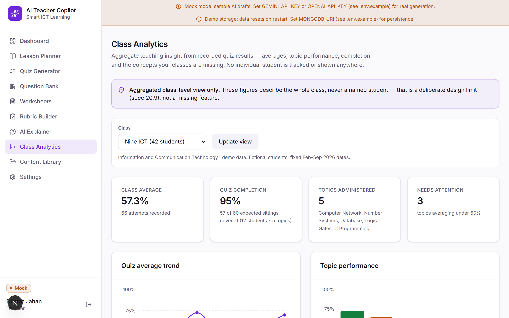
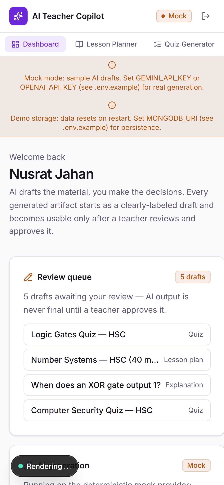

# Smart ICT Learning & AI Teacher Copilot

An AI-assisted teacher workspace for SSC/HSC ICT (and intro CSE) teaching:
lesson plans, quizzes, question banks, worksheets, rubrics, explanations
and class analytics — with one core philosophy:

**AI assists. The teacher decides.** Every generated artifact is a clearly
labeled draft until a teacher reviews, edits and approves it.

## Live Demo

> **Placeholder** — deploy link will be added here (Vercel, zero-env mock
> mode) when the project is published. The app runs fully offline in mock
> mode, so the demo needs no API keys.

## Screenshots

|                                        |                                         |
| -------------------------------------- | --------------------------------------- |
|  |  |
|  |  |
|  | |

> Screenshot captures are generated with the Playwright setup in this repo
> (`docs/screenshots/` — see `scripts/` in the reference workflow). The
> table above keeps stable references so images can be dropped in without
> editing the README structure.

## Problem

Bangladeshi ICT teachers (SSC/HSC and intro CSE) spend most of their prep
time producing the same artifacts over and over: lesson plans, MCQ quizzes,
question banks, practice worksheets, marking rubrics and simple
explanations of the concepts students get stuck on. Generic AI chat tools
help, but:

- output arrives as unstructured chat text, not classroom-ready documents;
- nothing is versioned, searchable or reusable across a department;
- a wrong answer looks identical to a right one — there is no review gate
  between "the model said it" and "my class sees it";
- student-facing tools drift toward surveillance; teachers need class-level
  insight, not per-student tracking.

## Educational Objective

Give every ICT teacher an AI copilot that drafts the material while the
teacher keeps full editorial control, so that:

- prep time drops from hours to minutes per artifact;
- every classroom artifact passes through an explicit **draft → teacher
  review → approve** gate, modeling responsible AI use for students;
- the question bank grows into a department-wide, tagged, reusable asset;
- class analytics surface *which topics* a class is missing — reteaching
  insight, never student surveillance.

## Features

- **Lesson Planner** — topic + level + duration in; a complete draft lesson
  plan (objectives, warm-up, explanation, activity, practice, assessment,
  homework, three-track differentiation) out. Every field editable.
- **Quiz Generator** — MCQ / true-false / short-answer / fill-blank / viva
  quizzes, 3–15 questions, with per-question editing, printing and export.
- **Question Bank** — 40 seeded + teacher-authored questions with topics,
  tags, difficulty, draft/published/archived lifecycle, bulk actions,
  duplicate, add-to-quiz, and published-only JSON/CSV export.
- **Worksheets** — sectioned printable practice sheets with answer keys and
  teacher notes; print-optimized route and a copyable plain-text view
  (approved worksheets only).
- **Rubric Builder** — criteria x performance-level tables with points that
  always sum correctly (totalPoints recomputed on every save).
- **AI Explainer** — turns a student's confusion into a simple explanation
  with analogy and step-by-step breakdown, for teacher or student audience;
  model uncertainty is stored and rendered, never hidden.
- **Class Analytics** — class averages, monthly trend, topic performance,
  completion rate and most-missed concepts from recorded quiz results.
  Aggregated class-level only — deliberately no individual-student view.
- **Review workflow everywhere** — every AI artifact is stamped
  `AI-generated draft — teacher review required` until its creator (or an
  admin) approves it; approval records who and when.
- **Honest demo mode** — with no API keys the mock provider generates
  deterministic, clearly-labeled sample drafts; a banner says exactly that.

## Technology Stack

| Layer      | Choice                                              |
| ---------- | --------------------------------------------------- |
| Framework  | Next.js 16.3.6 (App Router, Turbopack, RSC)         |
| UI         | React 19.3.0, Tailwind CSS v4.3.3 (`@theme`, no config file), lucide-react 1.48.0 |
| Charts     | recharts 3.10.1 (+ react-is 19.3.0)                 |
| Language   | TypeScript 5.9.3 (strict)                           |
| Validation | zod 4.6.5 (AI outputs, store boundary, forms)       |
| Database   | mongodb driver 7.6.0 (optional; in-memory demo store otherwise) |
| Auth       | scrypt (node:crypto) + HMAC-SHA256 signed cookies   |
| Tests      | Vitest 5.0.2 (+ happy-dom, Testing Library), Playwright 1.63.0 |
| Lint       | ESLint 9.39.0 (flat config, eslint-config-next 16.3.6) |

**AI provider matrix** — one `AiProvider` interface, three implementations:

| Provider | Endpoint                                        | Default model        | JSON mode                              | Notes |
| -------- | ----------------------------------------------- | -------------------- | -------------------------------------- | ----- |
| `gemini` | generativelanguage.googleapis.com v1beta `generateContent` | `gemini-2.5-flash` | `responseMimeType: application/json`   | Priority when both keys are set |
| `openai` | chat completions (`/v1/chat/completions`)       | `gpt-4o-mini`        | `response_format: { type: "json_object" }` | Fallback provider |
| `mock`   | none (deterministic templates)                  | `mock-template-v1`   | n/a                                    | No-key demo mode; content parameterized by teacher inputs, honestly labeled |

Selection: `AI_PROVIDER` override wins; else `GEMINI_API_KEY` → gemini,
else `OPENAI_API_KEY` → openai, else mock.

## Architecture

### Provider-agnostic AI layer

```
 UI (server components)
        │  form submit
        ▼
 Server Action  ("use server" — the ONLY place generation happens)
        │  build prompt (prompts/<kind>.ts)
        ▼
 getProvider() ─── AI_PROVIDER > GEMINI_API_KEY > OPENAI_API_KEY > mock
        │
        ▼
 ┌───────────────────────────── AiProvider ─────────────────────────────┐
 │  GeminiProvider        OpenAIProvider        MockProvider            │
 │  20s timeout           20s timeout           deterministic           │
 │  +1 transport retry    +1 transport retry    templates               │
 └───────────────────────────────┬──────────────────────────────────────┘
                                 │  raw text
                                 ▼
                      ┌──────────────────────┐
                      │  ZOD BOUNDARY        │  JSON.parse + artifact
                      │  (schemas/<kind>.ts) │  schema safeParse
                      └───────┬───────┬──────┘
                          ok  │       │ invalid
                              │       └──► ONE repair retry (validation
                              │            issues appended to the prompt)
                              │                │ still invalid
                              │                ▼
                              │            honest AiGenerationError
                              │            (nothing saved, no partial trust)
                              ▼
                    validated artifact  ──►  Store (status "draft")
```

No API key ever reaches the client: keys are read only inside server-side
modules, and the Settings page reports key *presence* as booleans, never
values.

### Review workflow (spec 20.10)

```
 Teacher fills generator form
        │
        ▼
 [ status: draft ]  badge: "AI-generated draft — teacher review required"
        │  any teacher may EDIT (edits recorded in updatedBy)
        │  only the creator or an ADMIN may approve
        ▼  approve action (server-enforced)
 [ status: approved ]  badge: "Teacher approved"
        approvedBy: <teacherId>   approvedAt: <timestamp>
```

Approved artifacts flow to the print surfaces (worksheet print/copy, quiz
print), the Content Library and the Quiz → Question Bank export.

### Application layout

- `src/app/(workspace)/*` — login-gated teacher workspace (all ten sections)
- `src/app/(auth)/login` — the only public page
- `src/app/(print)/*` — print/copy surfaces outside the workspace chrome
  (approved worksheets / quizzes only, `notFound()` otherwise)
- `src/app/actions/*` — server actions for every mutation + all AI generation
- `src/lib/ai/*` — providers, prompts, schemas, validation engine
- `src/lib/db/*` — `Store` interface, `DemoStore`, `MongoStore`, seeds
- `src/lib/auth/*` — scrypt hashing, HMAC session tokens, guards (no middleware)
- `src/components/*` — UI kit + per-feature editors

## Database Model

Two interchangeable stores behind one `Store` interface: **DemoStore**
(in-memory, lazily seeded, `globalThis`-cached) and **MongoStore** (mongodb
driver, every document zod-parsed at the boundary, indexes created on boot).
`MONGODB_URI` selects; absence = demo mode.

| Collection      | Document (zod-validated)                                                                 |
| --------------- | ---------------------------------------------------------------------------------------- |
| `users`         | `{ id, name, email (unique), passwordHash (scrypt), role: TEACHER\|ADMIN, createdAt }`    |
| `lessonPlans`   | `{ id, title, topic, classLevel, durationMin, objectives[], content: LessonPlan, promptInput, provider, model, status, approvedBy?, approvedAt?, createdBy/At/By }` |
| `quizzes`       | `{ id, topic, classLevel, questionCount, difficulty, language, content: QuizSpec, …same meta… }` |
| `questions`     | `{ id, question, type, difficulty, topic, learningObjective, options?, answer, explanation, tags[], status: draft\|published\|archived, source: ai\|manual, provider? , audit }` |
| `worksheets`    | `{ id, topic, classLevel, content: WorksheetSpec (sections + answerKey + teacherNotes), …same meta… }` |
| `rubrics`       | `{ id, assignmentTitle, topic, classLevel, content: RubricSpec (criteria x levels, totalPoints), …same meta… }` |
| `explanations`  | `{ id, question, confusion?, topic, audience, content: Explanation (+ uncertaintyNote?), …same meta… }` |
| `classGroups`   | `{ id, name (unique), subject, studentCount }`                                           |
| `quizResults`   | `{ id, classId, quizId?, topic, studentName (fictional), score, total, createdAt }`      |

Every AI artifact embeds its validated `content`, echoes the generation
inputs in `promptInput` (provenance), and stamps `provider` + `model`.

## Authentication and Authorization

- **scrypt** password hashing (`node:crypto`, unique salt per hash) —
  never plaintext, never reversible.
- Sessions are stateless HMAC-SHA256–signed cookies (`httpOnly`, `lax`,
  `secure` in production, 7-day expiry); tampered, expired or malformed
  tokens are rejected, and the token's role is cross-checked against the
  stored user on every request.
- **No middleware.ts** — every page, server action and route handler guards
  itself (`requireRole` / `apiGuard` from `src/lib/auth/guards.ts`).
- Exactly two roles (this is a teacher tool — no unnecessary roles):
  **TEACHER** and **ADMIN**. The whole app sits behind login; `/login` is
  the only public page.
- Review access rule: all teachers *see* every artifact; only the **creator
  or an admin** may *approve* it (enforced in the approve server actions,
  mirrored by hiding the approve button).

## Testing

| Suite            | What it covers |
| ---------------- | -------------- |
| `tests/*.test.ts(x)` (Vitest, 160 tests) | AI layer (provider selection matrix, mock roundtrips, schema validation, **repair-retry path**: invalid first response → one retry → honest error), auth (scrypt + session tokens, P01-style), stores (dual-store parity, review workflow, deletion guards, question lifecycle, dedup), analytics (completion-rate semantics), worksheets/rubrics (totalPoints consistency), explainer uncertainty handling, **env-status booleans (never values)**, **review-access rules (visibility vs approval, action-level enforcement, UI mirror)** |
| `tests/e2e/smoke.spec.ts` (Playwright) | anonymous redirect, login → dashboard (Mock provider chip + stats), Lesson Planner generate → draft badge → edit → approve, Quiz Generator 5-question MCQ → send to bank (count grows), Question Bank topic filter + JSON export download, Analytics charts — with **zero console errors** tolerated |

```bash
npm run test:run    # unit tests (Vitest)
npm run test:e2e    # browser smoke (starts dev server on :3005)
```

## Local Development

```bash
npm install
npm run dev         # http://localhost:3005  (dev script pins the port)
```

Sign in with a demo account (below). With **no env vars at all** the app is
fully usable in **mock mode**: generation runs on the deterministic mock
provider, every draft is honestly labeled "sample AI-generated draft", and
data lives in the in-memory demo store (seeded automatically, resets on
restart). Set `GEMINI_API_KEY` or `OPENAI_API_KEY` in `.env.local` for real
generation; set `MONGODB_URI` for persistence. `.env.example` documents
every variable.

```bash
npm run lint        # ESLint 9 (flat config)
npm run typecheck   # tsc --noEmit, strict
npm run build       # production build
npm run seed        # with MONGODB_URI: idempotent full seed; else: demo message
```

## Environment Variables

| Variable           | Required | Default              | Purpose |
| ------------------ | -------- | -------------------- | ------- |
| `GEMINI_API_KEY`   | no       | —                    | Google Gemini API key; selects the gemini provider (priority) |
| `OPENAI_API_KEY`   | no       | —                    | OpenAI API key; selects the openai provider when no Gemini key |
| `AI_PROVIDER`      | no       | `auto`               | Force a provider: `gemini` \| `openai` \| `mock` |
| `AI_MODEL`         | no       | provider default     | Override the model id (`gemini-2.5-flash` / `gpt-4o-mini`) |
| `MONGODB_URI`      | no       | — (demo store)       | MongoDB connection string; switches to MongoStore |
| `MONGODB_DB_NAME`  | no       | `ai_teacher_copilot` | Database name when Mongo is used |
| `SESSION_SECRET`   | prod     | demo fallback        | HMAC secret for session cookies — **must** be set in production |
| `NODE_ENV`         | auto     | —                    | `production` enables `secure` session cookies |

API keys are read only server-side and never serialized to the client; the
Settings page shows key presence (boolean chips) only.

## Deployment

**Vercel (recommended).** Import the repo and deploy — **no environment
variables needed** for the zero-key demo: the app runs in mock mode with
the in-memory demo store, so the deployment is immediately usable and
honest about being a demo. For a production deployment add:

- `GEMINI_API_KEY` or `OPENAI_API_KEY` — real generation;
- `MONGODB_URI` (+ `MONGODB_DB_NAME`) — persistence (e.g. Atlas free tier);
- `SESSION_SECRET` — a strong random value
  (`node -e "console.log(require('crypto').randomBytes(32).toString('hex'))"`).

After the first deploy with Mongo, run `npm run seed` locally with the same
`MONGODB_URI` to fill the demo dataset idempotently. All routes that read
cookies/store are `force-dynamic`, so no ISR surprises.

## Demo Accounts

Password for every account: `Demo@12345`

| Email                        | Role          |
| ---------------------------- | ------------- |
| `admin@demo.local`           | Administrator |
| `teacher@demo.local`         | Teacher       |
| `tanvir.teacher@demo.local`  | Teacher       |
| `shamima.teacher@demo.local` | Teacher       |

## Known Limitations

- **Mock provider output is template-based.** With no API keys, drafts are
  deterministic sample templates parameterized by your inputs — useful, but
  real generation requires `GEMINI_API_KEY` or `OPENAI_API_KEY`.
- **Analytics run on seeded sample data.** Class groups and quiz results
  are fictional (fixed Jan–Sep 2026 dates, 8–12 invented student names per
  class); there is no student-facing mode and no CSV import of real marks.
- **No student accounts.** Deliberate (spec 11): this is a teacher tool;
  students receive printed/approved artifacts, not logins.
- **Login throttling is in-memory and per-instance.** Login attempts are
  limited to 10 per email address per 10-minute window, but the counter
  lives in server memory: each serverless/multi-instance server enforces
  its own independent limit, and counters reset on restart.
- Demo mode resets on server restart (in-memory store) and there is no
  artifact version history beyond updated-by auditing.
- Bangla-language content generation works through the quiz language field,
  but the UI itself is English-only for now.

## Future Enhancements

- **Multilingual UI + content** (full Bangla interface and bilingual artifacts).
- **Version history** per artifact (diff between review rounds).
- **Collaboration** — shared department libraries, comments on drafts, and
  multi-teacher approval chains.
- Batch worksheet/quiz printing, SRS-style spaced review scheduling, and
  export to LMS formats (Moodle GIFT, QTI).

## Teaching Use Cases

- **New chapter tomorrow?** Generate the lesson plan draft tonight, edit the
  warm-up to your class's prior knowledge, approve, print.
- **Term quiz in 15 minutes** — generate an MCQ set on the exact topics,
  review each question, approve, send to the bank, print with answer key.
- **Differentiation made practical** — every lesson plan ships
  support/core/stretch tracks you can tune per class group.
- **Department knowledge base** — the question bank accumulates tagged,
  published questions across teachers and years; export the good ones as
  JSON/CSV for any format.
- **Reteach, don't guess** — analytics flag topics averaging under 60% and
  hand you the exact lesson-planner entry point to reteach them.

## Interview Talking Points

- **Provider-agnostic AI layer** — one interface, three backends, selected
  by env; swapping Gemini for any new vendor is one file, and the mock
  makes the whole product demoable without keys.
- **Schema-first trust boundary** — model output is data, never code:
  every response is zod-validated before persistence, with a single
  repair-retry strategy and honest failures instead of partial trust.
- **Human-in-the-loop as a data model** — review state (`draft`/`approved`,
  approver, timestamp) lives in the schema and is enforced server-side, not
  bolted on with a boolean in the UI.
- **Dual-mode persistence** — identical `Store` interface for an in-memory
  demo and MongoDB, with zod at the Mongo boundary so bad documents can't
  enter the app.
- **Security by construction** — keys never reach the client, stateless
  HMAC sessions with role re-verification, scrypt hashing, per-surface
  guards instead of middleware magic.
- **Honest demo mode** — the app never claims a real model was called when
  it wasn't; mock content is genuinely useful and clearly labeled.

## License

MIT — see [LICENSE](./LICENSE).
